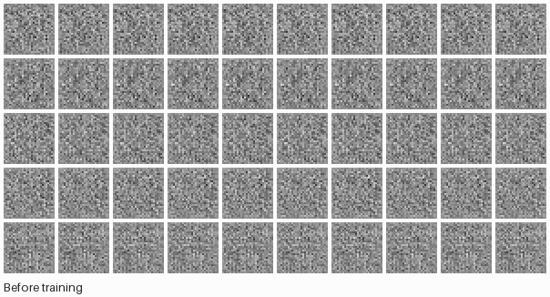
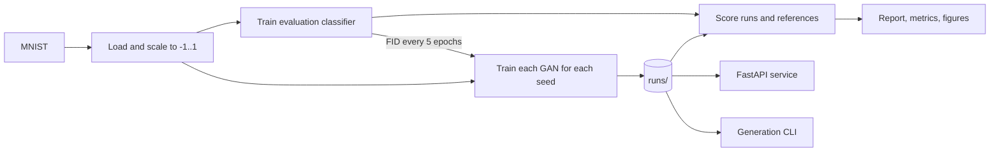
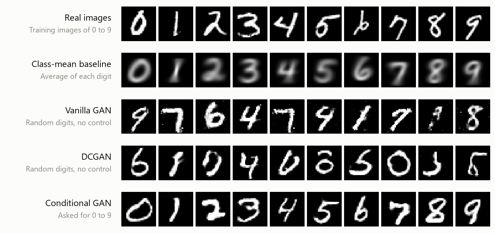
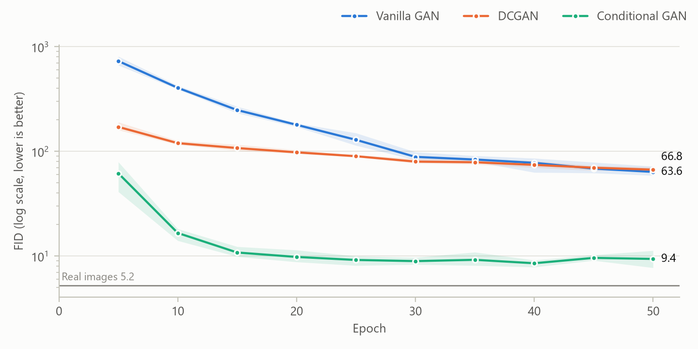
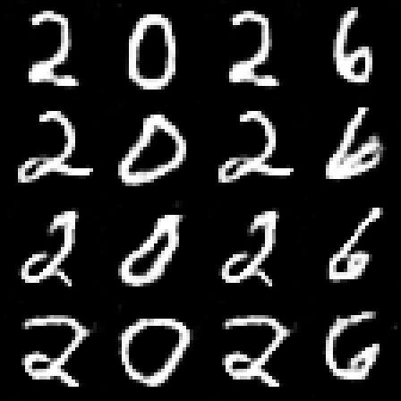

# Handwritten digit GAN

This project writes any number in generated handwriting. A conditional GAN trained on MNIST draws each digit on request, and a FastAPI service returns the result as a PNG.

The repository rebuilds a university coursework project as a controlled experiment. Three GANs of increasing complexity and a class-mean baseline are trained under identical settings, each GAN with three seeds, and scored with FID and classifier-based metrics as well as the pixel MSE the coursework used. The code is a typed Python package with tests, a reproducible pipeline, a container image, and CI.



## Contents

- [The question](#the-question)
- [How it works](#how-it-works)
- [Results](#results)
- [Writing numbers](#writing-numbers)
- [From coursework to repository](#from-coursework-to-repository)
- [Dataset](#dataset)
- [Getting started](#getting-started)
- [API](#api)
- [Project structure](#project-structure)
- [Limitations](#limitations)
- [Future improvements](#future-improvements)
- [Licence](#licence)

## The question

The coursework asked for a tool that generates a chosen digit, built in steps where each model addresses a weakness of the one before:

| Step | Model | What changes |
| --- | --- | --- |
| 0 | Class-mean baseline | The average training image of the requested digit, no learning |
| 1 | Vanilla GAN | Adversarial training with fully connected networks |
| 2 | DCGAN | Convolutions instead of dense layers |
| 3 | Conditional GAN | The DCGAN with the requested digit given to both networks |

Two questions follow: does each step produce better digits, and how should better be measured? The coursework compared models with pixel MSE and visual inspection. This repository adds metrics that separate realism from blur, real images as reference points, and repeated training runs.

## How it works



1. **Load** MNIST through torchvision and scale pixels to [-1, 1], the output range of the generators.
2. **Train an evaluation classifier**, a small CNN with 98.86% test accuracy. It is trained once and frozen, so every score comes from the same network.
3. **Train each GAN with seeds 42, 43, and 44** for 50 epochs with identical settings: batch size 128, Adam with learning rate 0.0002, one-sided label smoothing, and the non-saturating generator loss. FID is tracked every 5 epochs.
4. **Evaluate** every run, the baseline, and two sets of real images with the same code, the same 10,000 noise vectors, and the same test images.
5. **Serve** the conditional GAN through a CLI and an API that write whole numbers, with a seed for every picture so it can be reproduced.

[docs/architecture.md](docs/architecture.md) describes the networks, the training loop, the metrics, and the design decisions.

## Results

All numbers come from [docs/evaluation_report.md](docs/evaluation_report.md), which `scripts/evaluate_models.py` generates from the saved runs. GAN rows give the mean and standard deviation over three training seeds.

| Source | Pixel MSE | FID | Recognisable | Class balance | Correct digit |
| --- | --- | --- | --- | --- | --- |
| Real images, same digit | 0.418 | 2.71 | 96.7% | 1.000 | 99.0% |
| Real images, any digit | 0.520 | 2.54 | 96.7% | 0.999 | n/a |
| Class-mean baseline | 0.209 | 805.47 | 60.0% | 1.000 | 100.0% |
| Vanilla GAN | 0.516 ± 0.007 | 62.49 ± 9.68 | 80.2 ± 0.8% | 0.972 ± 0.005 | n/a |
| DCGAN | 0.527 ± 0.006 | 64.11 ± 4.42 | 66.6 ± 1.2% | 0.987 ± 0.002 | n/a |
| **Conditional GAN** | 0.419 ± 0.005 | **7.42 ± 0.78** | **97.2 ± 0.3%** | 1.000 ± 0.000 | **99.0 ± 0.2%** |

- **FID** compares generated and test images in the feature space of the evaluation classifier. Lower is better, and it rewards realism and variety together. Two independent sets of real images score about 2.5, the floor at this sample size.
- **Recognisable** is the share of samples the classifier assigns to one digit with at least 90% confidence.
- **Class balance** is the normalised entropy of the digits the classifier sees: 1.0 means all ten appear equally often.
- **Correct digit** is the share of samples classified as the requested digit.



How to read these numbers:

- **Conditioning is the change that matters.** The conditional GAN is the DCGAN with labels added and nothing else changed. FID falls from 64.1 to 7.4, the share of recognisable samples rises from 67% to 97%, and the requested digit comes out 99.0% of the time, the same rate at which the classifier recognises real training images. All three seeds agree.
- **The DCGAN is not a clear step up from the vanilla GAN.** Their FID ranges overlap, 62.5 ± 9.7 against 64.1 ± 4.4, and the two trade one weakness for another. The vanilla GAN draws a 1 in about one sample in five, twice the real share, while the DCGAN spreads its samples more evenly over the ten digits. In exchange, fewer of the DCGAN's samples are recognisable, 67% against 80%. Both differences hold in every seed. The DCGAN's strokes are smooth where the vanilla GAN's are speckled, as the coursework observed, but pixel MSE and a glance at ten samples cannot show the rest. Both networks are the coursework's small, untuned architectures, so the result says more about these two models than about convolutions in general.
- **Pixel MSE ranks the blurred average first.** The class mean minimises the expected squared error against unseen digits, and an independent real image scores about twice as much. Every GAN lands next to the real images it is compared with, 0.419 against 0.418 for the conditional GAN and about 0.52 for the others, so pixel MSE shows that the GANs produce handwriting-like images but cannot rank them. The conditional GAN's lower MSE comes from being compared with test images of the digit it was asked for.
- **The conditional GAN is slightly more recognisable than real handwriting**, 97.2% against 96.7%. GANs tend to produce typical, cleanly written digits and fewer of the ambiguous ones found in real data. FID, which also measures variety, still separates them: 7.4 against about 2.5.



The conditional GAN reaches most of its quality within 15 epochs, while the unconditional models are still improving at epoch 50. The tracked values use 2,000 samples, so they sit above the final 10,000-sample scores.

The evaluation report also has the loss curves, the digits the unconditional models produce, interpolations between handwriting styles, and the confusion matrix of the conditional GAN.

## Writing numbers

Each row reuses one noise vector, so the digits in a row share a handwriting style:

```bash
uv run python scripts/generate_digits.py --digits 2026 --variations 4 --seed 1
```



The seed is logged with every picture, and the CLI and the API return identical images for the same digits and seed. This is the picture seed 1 produces, not a selected example.

## From coursework to repository

The coursework consisted of five scripts, one per phase, and a report. Rebuilding it found problems that changed what the original comparison could show:

- **The DCGAN generated 24x24 images.** Its last transposed convolution used padding 3 instead of 1. An adaptive pooling layer in the discriminator hid the shape mismatch, so training ran, but real and generated images differed in size. The script's MSE step fails on the same mismatch, so the reported DCGAN MSE cannot come from the submitted code.
- **The comparison was not controlled.** Label smoothing and correctly sized output were only in the conditional GAN, so the DCGAN-to-cGAN step changed three things at once. Here every GAN shares the same training settings and that step changes only conditioning.
- **The baseline was scored on all 10,000 test images and the GANs on the first 1,000.** On the first 1,000, the baseline scores 0.209 instead of 0.2117.

The coursework MSE values reproduce closely: 0.516, 0.527, and 0.419 here, averaged over three seeds, against 0.5119, 0.5212, and 0.4129 in the report. Its conclusions that the conditional GAN is the best model and that MSE is a weak metric hold up. The claim that the DCGAN improves on the vanilla GAN does not: the two trade recognisable digits for class balance. [docs/coursework.md](docs/coursework.md) lists every change and checks each conclusion of the report against the new results. The original report is in [docs/coursework_report.pdf](docs/coursework_report.pdf).

## Dataset

[MNIST](https://pytorch.org/vision/stable/generated/torchvision.datasets.MNIST.html): 70,000 greyscale images of handwritten digits, 28x28 pixels, split into 60,000 for training and 10,000 for testing. The digits come from NIST Special Databases 1 and 3, written by American high-school students and Census Bureau employees. The split is fixed and used as published.

torchvision downloads the files into `data/MNIST/` on the first run and checks their MD5 sums. Nothing in `data/` is committed, and the dataset is not redistributed here.

The dataset was introduced in: Yann LeCun, Léon Bottou, Yoshua Bengio, and Patrick Haffner. *Gradient-based learning applied to document recognition.* Proceedings of the IEEE, 86(11), 1998.

## Getting started

### Requirements

- Python 3.12 or newer and [uv](https://docs.astral.sh/uv/) 0.13 or newer
- GNU Make, optional because each target is one short command. On Windows, `winget install ezwinports.make` installs it.
- Docker, optional

PyTorch is installed from its CPU wheel index. A GPU is not needed.

### Install

```bash
make install
```

This creates `.venv` from `uv.lock` and installs the pre-commit hooks.

### Download the trained model

```bash
make download-model
```

This saves the conditional GAN trained with seed 42, the model the API serves, from the [v0.1.0 release](https://github.com/Samiicodes/handwritten-digit-gan/releases/tag/v0.1.0) to `runs/cgan_seed42/generator.pt`. It is enough for [Writing numbers](#writing-numbers) and the API. Training is only needed to reproduce the results.

### Train

```bash
make train-cgan   # the conditional GAN the API serves, one seed
make train        # every GAN with every seed
```

The first run downloads MNIST and trains the evaluation classifier. After that, training the conditional GAN with one seed prints:

```text
Loading dataset
Loaded 60,000 training and 10,000 test images
Loaded classifier with test accuracy 98.86%
Training cgan with seed 42
Epoch 5/50: generator loss 1.456, discriminator loss 1.057, FID 41.08
Epoch 10/50: generator loss 1.115, discriminator loss 1.233, FID 14.00
Epoch 15/50: generator loss 1.043, discriminator loss 1.272, FID 9.86
Epoch 20/50: generator loss 1.025, discriminator loss 1.274, FID 9.20
Epoch 25/50: generator loss 1.035, discriminator loss 1.264, FID 9.41
Epoch 30/50: generator loss 1.069, discriminator loss 1.251, FID 8.29
Epoch 35/50: generator loss 1.102, discriminator loss 1.227, FID 8.59
Epoch 40/50: generator loss 1.138, discriminator loss 1.211, FID 8.61
Epoch 45/50: generator loss 1.175, discriminator loss 1.187, FID 9.06
Epoch 50/50: generator loss 1.203, discriminator loss 1.173, FID 9.14
Saved runs/cgan_seed42
Done
```

On an 8-core laptop CPU a convolutional GAN takes 70 to 90 minutes and the vanilla GAN about 23 minutes, so the full study of nine runs takes about 9 hours. Runs are ordered by seed, so an interrupted session keeps every completed seed. `scripts/train_models.py` accepts `--models`, `--seeds`, `--epochs`, and `--train_size` for shorter experiments.

### Evaluate

```bash
make evaluate   # write reports/evaluation_report.md, metrics.json, and figures
make docs       # the same, then copy the report and figures into docs/
```

The evaluation scores whichever runs exist, so it also works after `make train-cgan` alone.

### Test and lint

```bash
make test   # pytest with coverage, fails below 90%
make lint   # ruff and mypy in strict mode
```

The 91 tests cover 99% of the package. They build MNIST-shaped data in memory and run the whole pipeline on it, from training to the report, in about 30 seconds, so they need neither the dataset nor network access.

### Serve

```bash
make serve   # http://127.0.0.1:8000, interactive documentation at /docs
```

The service loads `runs/cgan_seed42/generator.pt` at startup, so download or train it first. `DIGITGAN_CHECKPOINT_PATH` selects another run; [.env.example](.env.example) lists every setting.

### Docker

```bash
make docker-build
make docker-run   # serves the generator in runs/, mounted read-only
```

The image contains the code but no trained model, so `make docker-run` mounts `runs/` from the host.

## API

| Method and path | Description |
| --- | --- |
| `GET /generate` | Write a number. Returns a PNG. |
| `GET /health` | `200` with the model being served, or `503` when none is loaded |
| `GET /docs` | Interactive OpenAPI documentation |

`/generate` takes these query parameters:

| Parameter | Default | Limits | Meaning |
| --- | --- | --- | --- |
| `digits` | required | 1 to 32 characters, 0 to 9 only | The number to write |
| `variations` | 1 | 1 to 8 | Rows, one handwriting style each |
| `seed` | random | 0 to 2,147,483,647 | Noise seed, returned in the `X-Seed` header |
| `scale` | 4 | 1 to 8 | Pixel enlargement |

```bash
curl -s -D - -o 2026.png 'http://127.0.0.1:8000/generate?digits=2026&variations=4&seed=1'
```

```text
HTTP/1.1 200 OK
x-seed: 1
content-length: 7183
content-type: image/png
```

The PNG is the picture shown under [Writing numbers](#writing-numbers). Invalid input returns `422` with the reason:

```json
{"detail": [{"type": "less_than_equal", "loc": ["query", "variations"], "msg": "Input should be less than or equal to 8", "input": "9", "ctx": {"le": 8}}]}
```

`/health` names the run being served:

```json
{"status": "ok", "version": "0.1.0", "model_name": "cgan", "training_seed": 42}
```

If the checkpoint is missing or unconditional, the service still starts, logs the reason, and answers `503`, so an orchestrator can tell a misconfigured instance from a crashed one. Each request is logged with its method, path, status, and latency. On a laptop a request for four rows of four digits takes about 11 ms; the first after startup takes about 70 ms.

## Project structure

```text
handwritten-digit-gan/
├── config/config.yaml          Training, evaluation, and service settings
├── data/                       MNIST, downloaded on first use, not committed
├── docs/                       Architecture, model card, coursework notes, evaluation report
├── reports/                    Output of the latest local evaluation, not committed
├── runs/                       Trained generators and the classifier, not committed
├── scripts/
│   ├── train_models.py
│   ├── evaluate_models.py
│   ├── generate_digits.py
│   └── run_api.py
├── src/digitgan/
│   ├── config.py               Typed settings and environment overrides
│   ├── data.py                 MNIST loading, scaling, seeded batches
│   ├── models.py               Generators and discriminators
│   ├── baseline.py             The class-mean baseline
│   ├── training.py             The adversarial training loop
│   ├── checkpoints.py          Checkpoint format and safe loading
│   ├── generation.py           Sampling, numbers, interpolation, pictures
│   ├── classifier.py           The evaluation classifier
│   ├── evaluation.py           Image sources, metrics, aggregation over seeds
│   ├── plotting.py             Figures and the training animation
│   ├── reporting.py            The evaluation report and metrics.json
│   ├── pipeline.py             Training and evaluation entry points
│   └── api.py                  FastAPI service
├── tests/                      Unit tests and an end-to-end pipeline test
├── .github/workflows/ci.yml    Lint, type check, test, smoke run, and image smoke test
├── Dockerfile
├── Makefile
└── pyproject.toml
```

## Limitations

- MNIST is small, centred, and greyscale. Results on it say little about harder image domains.
- FID here uses a small MNIST classifier rather than Inception, so values are only comparable within this project. The classifier-based metrics share the classifier's blind spots.
- Three seeds show whether a result is stable, but they are too few for confidence intervals.
- Every model uses the coursework's architecture and hyperparameters without tuning. The DCGAN in particular is much smaller than the one in Radford et al., and its ranking may change with tuning.
- The final checkpoint after 50 epochs is used, not the one with the best tracked FID.
- Variety within a digit is measured only indirectly, through FID. Memorisation of training images is not checked.
- The service generates on the CPU in the request thread and has no authentication or rate limiting beyond its query limits.

## Future improvements

- Tune the DCGAN, for example with wider layers and without dropout, to test whether the ladder then improves at every step.
- Add a conditional vanilla GAN to separate the effect of conditioning from that of convolutions.
- Report precision and recall for generative models (Kynkäänniemi et al., 2019), which split FID into fidelity and coverage.
- Check for memorisation by comparing samples with their nearest training images.
- Compare with a small diffusion model trained on the same budget, as the coursework suggested.

## Licence

The code is released under the MIT licence, see [LICENSE](LICENSE). MNIST is not part of this repository.
