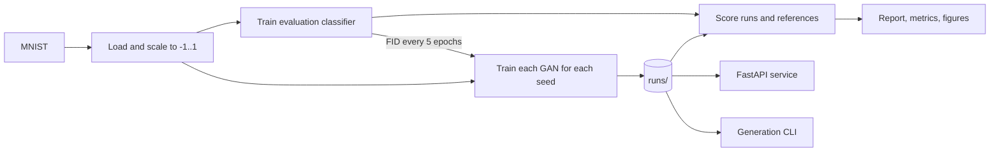

# Architecture

This document describes how the experiment is set up, how each stage works, and why the main design decisions were made.

## Pipeline

1. **Load.** torchvision downloads MNIST and checks the MD5 sums. Both splits are held in memory as tensors scaled to [-1, 1], the output range of the generators' tanh. This is the coursework preprocessing, `ToTensor` followed by `Normalize(0.5, 0.5)`, done once instead of per image.
2. **Train the evaluation classifier** on the 60,000 training images. It is trained once, saved, and reused, so every score in every run comes from the same frozen network.
3. **Train the GANs.** Each model is trained once per seed. Runs are ordered by seed, so an interrupted session leaves whole seeds behind. Every 5 epochs the training loop measures FID on 2,000 samples, and after every epoch it saves the same 100 fixed samples as a progress frame.
4. **Evaluate.** Every saved run, the baseline, and two sets of real images are scored by the same `Evaluator`. The report, `metrics.json`, and the figures are written to `reports/`.
5. **Serve.** The API and the CLI load one conditional generator and write any number on request.

## Experimental design

The coursework brief asked for a controlled comparison: the same data split, preprocessing, training budget, and evaluation for every method. Everything below is shared by the three GANs.

| Setting | Value |
| --- | --- |
| Training data | The fixed MNIST training split, 60,000 images |
| Preprocessing | Pixels scaled to [-1, 1] |
| Epochs | 50 |
| Batch size | 128 |
| Optimiser | Adam with learning rate 0.0002 and betas 0.5 and 0.999, for both networks |
| Noise | 100 standard normal values |
| Loss | Binary cross-entropy on logits, non-saturating for the generator |
| Discriminator target for real images | 0.9 (one-sided label smoothing) |
| Seeds | 42, 43, and 44 |
| Evaluation | The same classifier, test images, sample sizes, and noise for every model |

Each step up the ladder changes one thing:

| Model | Generator | Discriminator | What changes | Generator parameters |
| --- | --- | --- | --- | --- |
| Class-mean baseline | The mean training image of the requested digit | None | Starting point, no learning | 0 |
| Vanilla GAN | Fully connected: 100, 256, 512, 1024, 784 | Fully connected: 784, 1024, 512, 256, 1 | Adversarial learning | 1,486,352 |
| DCGAN | Linear to 128 maps of 7x7, two transposed convolutions to 28x28 | Two strided convolutions from 28x28 to 7x7, then linear | Convolutions instead of dense layers | 766,017 |
| Conditional GAN | DCGAN generator with a 10-value label embedding appended to the noise | DCGAN discriminator with a learned 28x28 label map as a second input channel | Both networks know the requested digit | 828,837 |

The discriminators have 1,460,225, 138,817, and 147,681 parameters.

The networks live in `src/digitgan/models.py`. Every architecture supports conditioning, so the conditional GAN is the DCGAN built with `conditional=True` rather than a separate class. A conditional vanilla GAN, which is how Mirza and Osindero first demonstrated conditioning, is one configuration entry away but is not part of the study.

## Training loop

`train_gan` in `src/digitgan/training.py` runs the same loop for every model:

1. **Discriminator step.** Score a real batch and a generated batch. The generated images are detached so that this update does not reach the generator. The loss is the sum of binary cross-entropy against 0.9 for real images and 0 for generated ones.
2. **Generator step.** Generate a fresh batch from new noise and score it. The generator is trained to make the discriminator output 1, the non-saturating loss from Goodfellow et al., which gives stronger gradients early in training than minimising log(1 - D(G(z))).

Conditional models pass the batch's real labels to both networks in both steps.

The discriminators output logits, and the loss is `BCEWithLogitsLoss`. This is the same objective as a sigmoid followed by `BCELoss`, as in the coursework, but it is computed in a numerically stable way.

Label smoothing is one-sided, as recommended by Salimans et al.: only the discriminator's target for real images is lowered. The generator still aims for 1.0.

### What a seed controls

`torch.manual_seed(seed)` fixes weight initialisation, training noise, and dropout. The batch order comes from a separate generator seeded with the same value. Progress frames, FID tracking, and evaluation draw their noise from private generators, so measuring a run never changes how it trains. Rerunning a seed on the same machine reproduces it exactly: an interrupted run restarted from scratch logged identical FID values.

## Evaluation

### Why a classifier, and why not Inception

FID normally compares Inception-v3 features. Inception was trained on colour photographs at 299x299 pixels, and its features for 28x28 greyscale digits say little about handwriting. A small convolutional network trained on MNIST is the usual substitute for this dataset. Its 128-unit penultimate layer provides the features for FID, and its predictions provide the classifier-based metrics. It reaches 98.86% accuracy on the test split.

The consequence is that FID values here are only comparable with each other, not with published FID values for other datasets or feature extractors.

### Reference sources

The evaluator scores three sources that involve no GAN:

- **Real images, same digit**: a random training image of the requested digit. This is what a perfect conditional generator would produce.
- **Real images, any digit**: a random training image. This is what a perfect unconditional generator would produce.
- **Class-mean baseline**: the average training image of the requested digit.

They are scored exactly like the GANs, which turns every metric into something that can be read against what real handwriting scores.

### Metrics

| Metric | Computed from | Good value | Blind spot |
| --- | --- | --- | --- |
| Pixel MSE | Each of the first 1,000 test images and one generated image | Lower is closer pixel by pixel | Rewards blurry averages and low variety; see below |
| FID | Classifier features of 10,000 generated images against all 10,000 test images | Lower | Only first and second moments of the features |
| Recognisable | Share of samples with a top class probability of at least 0.9 | Higher | A confident classifier can still be fooled |
| Class balance | Normalised entropy of the predicted digits | 1.0 | Says nothing about variety within a digit |
| Correct digit | Share of conditional samples classified as the requested digit | Higher | Applies to conditional sources only |

For every run, 10,000 images are generated, 1,000 of each digit, from the same noise vectors (evaluation seed 0). Unconditional models receive the same noise and ignore the digits.

### Why pixel MSE cannot rank generators

The class mean is the image with the lowest expected squared error against unseen images of that digit, so no generator can beat the baseline on this metric. An independently drawn real image x' of the same digit scores about twice the baseline, because for independent x and x' with mean m:

E||x - x'||^2 = E||x - m||^2 + E||x' - m||^2

So perfect handwriting scores about 0.42 on this protocol while the blurred average scores 0.21. Any generator that outputs less ink or less variety than real handwriting moves towards the mean and scores better than real data. Unconditional models are compared with test images of arbitrary digits, so their scores sit on a different scale again. The pixel MSE chart therefore groups sources by how they were paired.

## Package layout

| Module | Responsibility |
| --- | --- |
| `config.py` | Typed settings from `config/config.yaml`, with environment overrides |
| `data.py` | MNIST loading, pixel scaling, seeded batching |
| `models.py` | Generators and discriminators |
| `baseline.py` | The class-mean baseline |
| `training.py` | The adversarial training loop and saving runs |
| `checkpoints.py` | Checkpoint format, saving and safe loading |
| `generation.py` | Sampling, writing numbers, interpolation, turning samples into pictures |
| `classifier.py` | The evaluation classifier |
| `evaluation.py` | Image sources, metrics, and aggregation across seeds |
| `plotting.py` | Figures and the training animation |
| `reporting.py` | The Markdown report and `metrics.json` |
| `pipeline.py` | The training and evaluation entry points the scripts call |
| `api.py` | The FastAPI service |

## Checkpoints

A run directory such as `runs/cgan_seed42/` holds:

- `generator.pt`: the generator weights with the model name, architecture, conditioning, noise size, seed, per-epoch history, and library versions.
- `progress.npz`: 8-bit progress frames, one before training and one per epoch.

Checkpoints are loaded with `torch.load(weights_only=True)`, which refuses arbitrary pickled objects, so opening a tampered file cannot run code. Everything stored is a tensor or a plain Python value for that reason.

## Service

`create_app` in `src/digitgan/api.py` builds a FastAPI application around one conditional generator.

- The generator is loaded once at startup. If it is missing or unconditional, the service still starts, logs the reason, and returns `503` from `/health` and `/generate`, so a container orchestrator can tell a misconfigured instance from a crashed one.
- `/generate` writes each requested digit once per variation. All digits in a row share one noise vector, which keeps the handwriting style of the row consistent.
- The noise seed is returned in the `X-Seed` header, so any picture can be reproduced.
- Query limits (32 digits, 8 variations, scale 8) bound the work a single request can cause.
- Each request is logged with method, path, status, and latency.

## Reproducibility

- `uv.lock` pins every package, and resolution ignores releases after a fixed date.
- PyTorch comes from the CPU wheel index. The default Linux wheels add several gigabytes of CUDA libraries that a 28x28 dataset does not need.
- Every random choice is seeded from the configuration.
- Results are exactly reproducible on the same machine and library versions. A different CPU or thread count can change floating-point summation order and so the exact numbers, but not the conclusions.
