# Evaluation report

Generated by `scripts/evaluate_models.py` from the saved training runs. Rerun the script rather than editing this file.

## Setup

| Setting | Value |
| --- | --- |
| Training images | 60,000 from the MNIST training split |
| Test images | 10,000 from the MNIST test split |
| Epochs | 50 |
| Batch size | 128 |
| Optimiser | Adam, learning rate 0.0002, betas 0.5 and 0.999 |
| Noise dimension | 100 |
| Discriminator target for real images | 0.9 (one-sided label smoothing) |
| Training seeds | 42, 43, 44 |
| Evaluation classifier | 98.9% accuracy on the test split |
| Generated images per run | 10,000, the same number of each digit |
| Pixel MSE images | The first 1,000 test images |

## Results

GAN rows give the mean and standard deviation across training seeds. Real images and the baseline involve no training, so they have a single value.

| Source | Runs | Pixel MSE | FID | Recognisable | Class balance | Correct digit |
| --- | --- | --- | --- | --- | --- | --- |
| Real images, same digit | 1 | 0.418 | 2.71 | 96.7% | 1.000 | 99.0% |
| Real images, any digit | 1 | 0.520 | 2.54 | 96.7% | 0.999 | n/a |
| Class-mean baseline | 1 | 0.209 | 805.47 | 60.0% | 1.000 | 100.0% |
| Vanilla GAN | 3 | 0.516 ± 0.007 | 62.49 ± 9.68 | 80.2 ± 0.8% | 0.972 ± 0.005 | n/a |
| DCGAN | 3 | 0.527 ± 0.006 | 64.11 ± 4.42 | 66.6 ± 1.2% | 0.987 ± 0.002 | n/a |
| Conditional GAN | 3 | 0.419 ± 0.005 | 7.42 ± 0.78 | 97.2 ± 0.3% | 1.000 ± 0.000 | 99.0 ± 0.2% |

What each column measures:

- **Pixel MSE** is the coursework metric: the mean squared pixel difference between one generated image and each of the first 1,000 test images. Conditional sources are asked for the digit of the test image they are compared with, unconditional sources are not, so the two groups are only comparable within themselves. The real-image rows show what real handwriting scores.
- **FID** is the Frechet distance between generated and test images in the feature space of the evaluation classifier. It rewards realism and variety together. It is not comparable with FID values computed with an Inception network.
- **Recognisable** is the share of images that the classifier assigns to one digit with a probability of at least 90%.
- **Class balance** is the normalised entropy of the digits the classifier sees. A value of 1.0 means all ten digits appear equally often; lower values point to mode collapse.
- **Correct digit** is the share of images classified as the digit that was requested. It applies only to sources that take a digit as input.

## Results per run

| Source | Seed | Pixel MSE | FID | Recognisable | Class balance | Correct digit |
| --- | --- | --- | --- | --- | --- | --- |
| Vanilla GAN | 42 | 0.512 | 54.86 | 81.0% | 0.977 | n/a |
| Vanilla GAN | 43 | 0.513 | 73.37 | 79.4% | 0.966 | n/a |
| Vanilla GAN | 44 | 0.524 | 59.23 | 80.2% | 0.974 | n/a |
| DCGAN | 42 | 0.524 | 69.19 | 65.3% | 0.984 | n/a |
| DCGAN | 43 | 0.533 | 61.99 | 67.5% | 0.989 | n/a |
| DCGAN | 44 | 0.523 | 61.15 | 67.1% | 0.988 | n/a |
| Conditional GAN | 42 | 0.423 | 7.70 | 97.0% | 1.000 | 99.0% |
| Conditional GAN | 43 | 0.421 | 8.03 | 97.6% | 1.000 | 99.2% |
| Conditional GAN | 44 | 0.413 | 6.54 | 97.1% | 1.000 | 98.7% |

## Training time

Wall-clock time per run, including the FID checks, measured on the machine that produced this report. Totals also count any time the machine was suspended during a run. The median epoch does not, so it is the better guide to speed.

| Run | Epochs | Median seconds per epoch | Total minutes |
| --- | --- | --- | --- |
| Vanilla GAN, seed 42 | 50 | 27.7 | 23.0 |
| Vanilla GAN, seed 43 | 50 | 25.6 | 21.9 |
| Vanilla GAN, seed 44 | 50 | 26.6 | 23.2 |
| DCGAN, seed 42 | 50 | 86.0 | 88.5 |
| DCGAN, seed 43 | 50 | 85.2 | 71.7 |
| DCGAN, seed 44 | 50 | 92.1 | 79.0 |
| Conditional GAN, seed 42 | 50 | 93.6 | 94.3 |
| Conditional GAN, seed 43 | 50 | 101.8 | 89.5 |
| Conditional GAN, seed 44 | 50 | 85.8 | 181.3 |

## Figures

### Samples from each source

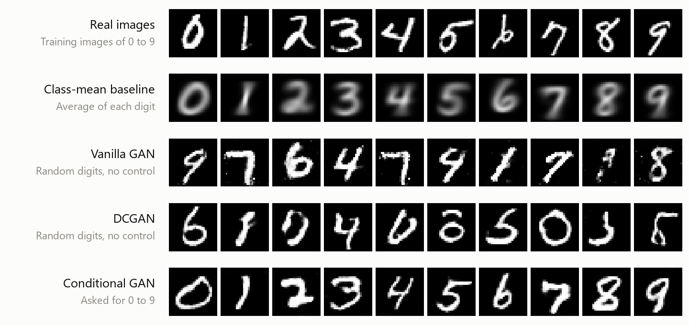

### Vanilla GAN samples

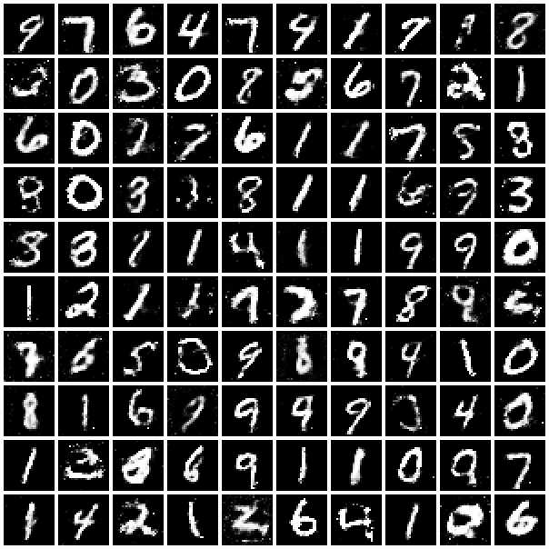

### DCGAN samples

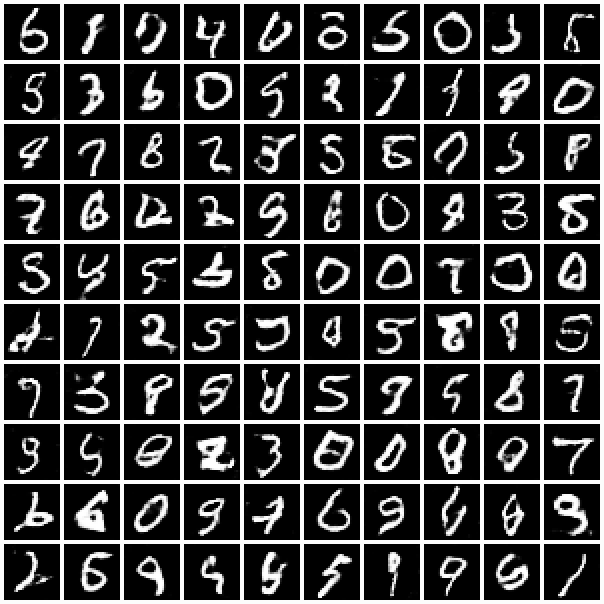

### Conditional GAN samples: one noise vector per row, digits 0 to 9 across

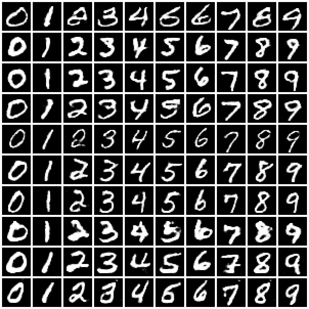

### Conditional GAN during training

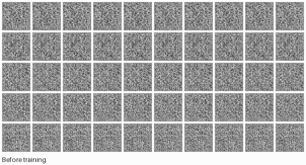

### Conditional GAN: moving between two noise vectors for each digit

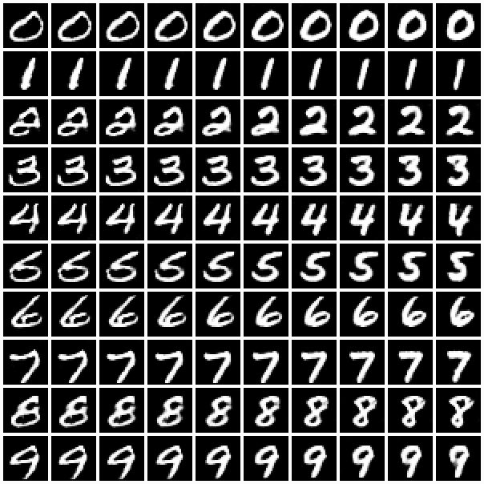

### Pixel MSE, compared like for like

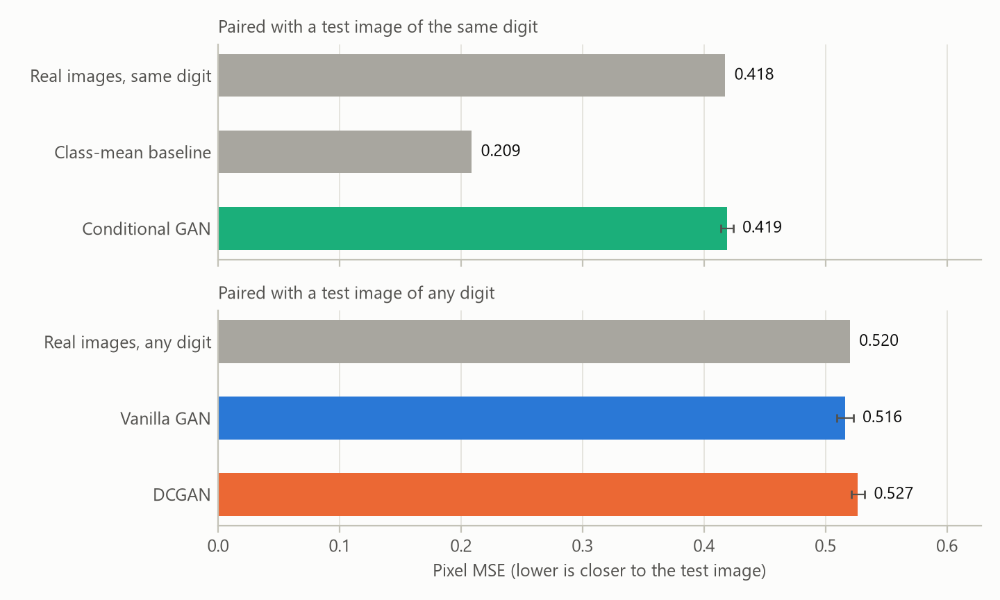

### FID during training

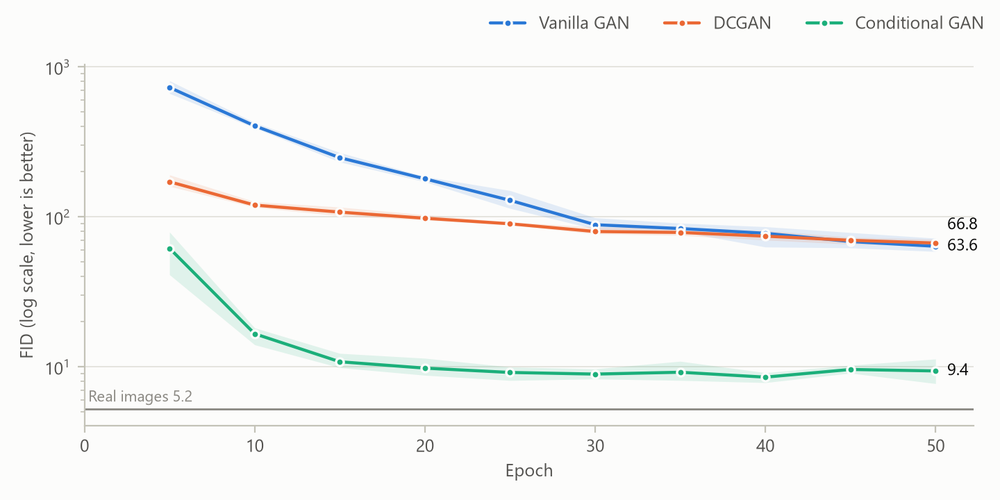

### Training losses

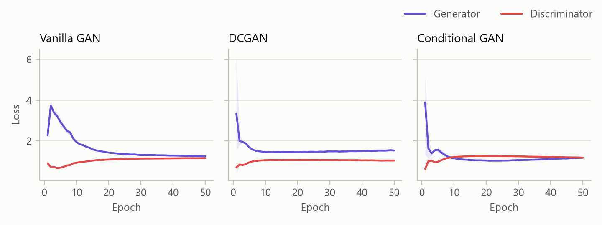

### Digits produced without conditioning

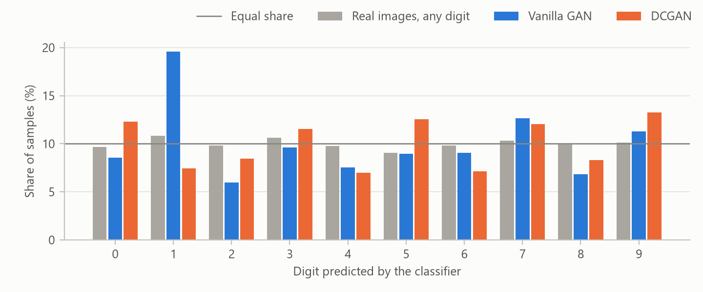

### Conditional GAN: requested digit against classified digit

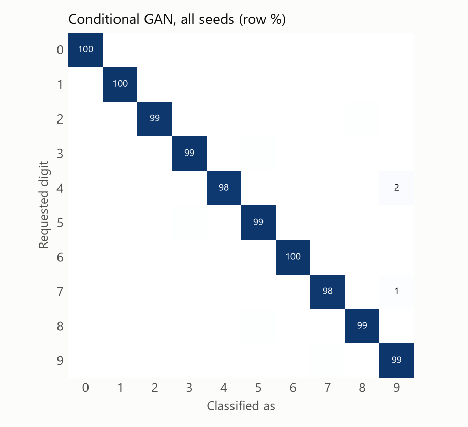
