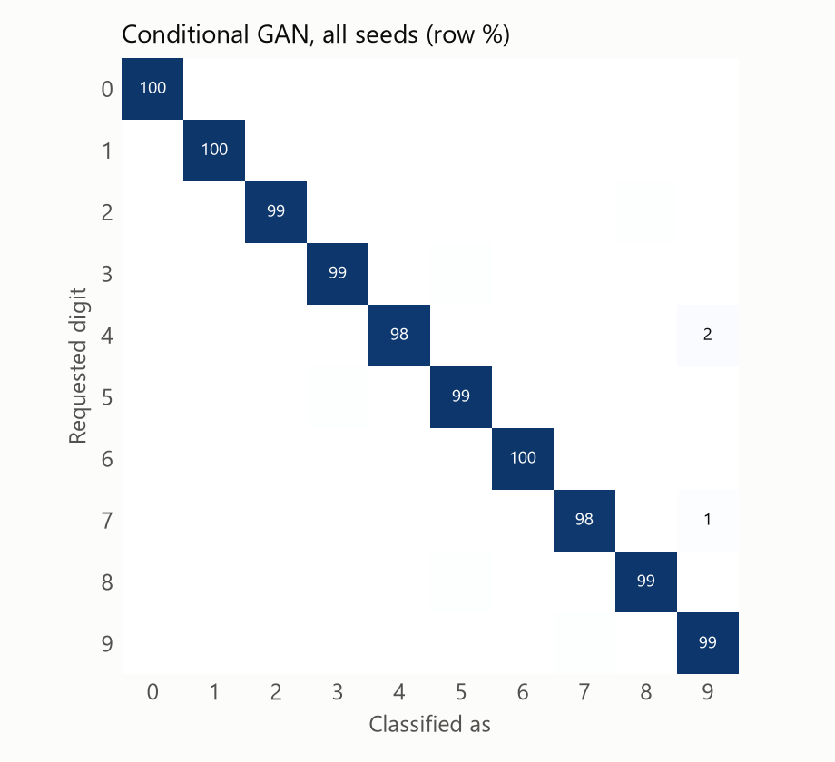

# Model card: digitgan conditional generator

The API and the CLI serve `runs/cgan_seed42/generator.pt`, the conditional GAN trained with seed 42. It is attached to the [v0.1.0 release](https://github.com/Samiicodes/handwritten-digit-gan/releases/tag/v0.1.0), and `make download-model` puts it in place. Figures on this page come from [evaluation_report.md](evaluation_report.md), which has the numbers for every run.

## Model details

| Item | Value |
| --- | --- |
| Type | Generator of a conditional GAN with DCGAN-style convolutional networks |
| Generator | A 10-value learned embedding of the digit, appended to 100 standard normal noise values. A linear layer maps them to 128 maps of 7x7, and two transposed convolutions with batch normalisation and LeakyReLU upsample to one 28x28 map with tanh. |
| Parameters | 828,837 in the generator. The discriminator, 147,681 parameters, is only used in training. |
| Input | A digit from 0 to 9 and a noise vector drawn from a seed |
| Output | A 28x28 greyscale image with values in [-1, 1], rendered as an 8-bit PNG |
| Training | 50 epochs over the 60,000 MNIST training images, batch size 128, Adam with learning rate 0.0002 and betas 0.5 and 0.999, one-sided label smoothing at 0.9, non-saturating generator loss |
| Training time | About 80 minutes on an 8-core laptop CPU |
| Code licence | MIT |

The checkpoint also holds the training history and the library versions it was trained with. It is loaded with `torch.load(weights_only=True)`, so a tampered file cannot run code.

## Intended use

- **Intended:** demonstrating conditional image generation and how to evaluate it, and writing numbers in MNIST-style handwriting for demonstrations and teaching.
- **Users:** engineers and students studying GANs, and reviewers of this repository.
- **Out of scope:**
  - Training or testing digit recognisers on generated digits without checking that the results carry over to real handwriting. Generated digits are more typical than real ones, so a recogniser tested on them would look better than it is.
  - Imitating a particular person's handwriting. The model has no notion of individual writers and cannot be steered towards one.
  - Anything other than isolated digits in the MNIST format: letters, higher resolutions, and colour are all outside what it learned.

## Data

The MNIST training split: 60,000 digits, between 5,421 and 6,742 of each. They come from NIST Special Databases 1 and 3, written by American high-school students and Census Bureau employees, and were size-normalised and centred in a 28x28 frame. The 10,000 test images were used only for evaluation.

The model can only reproduce styles present in this data: digits written in one stroke colour on a clean background, by writers from one country.

## Evaluation

10,000 images were generated, 1,000 of each digit, from fixed noise, and scored against the 10,000 test images with a separate MNIST classifier that reaches 98.86% test accuracy.

| Metric | This model | Real images of the same digit |
| --- | --- | --- |
| FID in classifier feature space, lower is better | 7.70 | 2.71 |
| Recognisable: classified with at least 90% confidence | 97.0% | 96.7% |
| Classified as the requested digit | 99.0% | 99.0% |
| Class balance, 1.0 when all digits are equally common | 1.000 | 1.000 |
| Pixel MSE against the first 1,000 test images | 0.423 | 0.418 |

Seed 42 was served because it is the first seed, not because it scored best. The same model trained with seeds 43 and 44 reaches FID 8.03 and 6.54, so the served model is typical of the three.

The model writes the requested digit as reliably as the classifier recognises real ones. The weakest digits are 4, 7, and 9, at about 98% each. The most common errors are a requested 4 classified as a 9, in 1.7% of cases, and a 7 classified as a 9, in 1.1%. A 4 read as a 9 is also the most common error with the other two seeds. The figure below combines all three.

FID stays well above that of real images. Combined with the recognisable rate above real data, this suggests that the model writes typical digits well but covers less of the variety in real handwriting.

## Limitations

- **Not every sample is good.** Some noise vectors produce malformed digits or broken strokes. The README's 2026 example, which was not selected, shows a few.
- **Less varied than real handwriting.** See the evaluation above.
- **Memorisation is not checked.** Some samples may be close copies of training images.
- **The metrics depend on one MNIST classifier** and share its blind spots. FID values are not comparable with FID computed with Inception features.
- **Not the best checkpoint.** Tracked FID was lowest at epoch 30, and the model after epoch 50 is served.
- **Untuned.** The architecture and hyperparameters are the coursework's.

## Ethical considerations

- **The training data is real people's handwriting**, collected by NIST and published for research. The model learns styles from it and may reproduce near-copies of individual training digits.
- **The potential for misuse is low.** Isolated 28x28 digits are of little use for forging documents or signatures.
- **Generated data can flatter other systems.** Generated digits are cleaner than real ones, so using them to train or test another model can give a misleading picture of its accuracy.

## Caveats and recommendations

- Pass a seed when a result must be reproducible. The API returns the seed it used in the `X-Seed` header.
- Exact outputs depend on the PyTorch version and the CPU. Results from another machine may differ slightly, but not in quality.
- Set `DIGITGAN_CHECKPOINT_PATH` to serve the generator from another seed. [evaluation_report.md](evaluation_report.md) shows how much the seeds differ.
